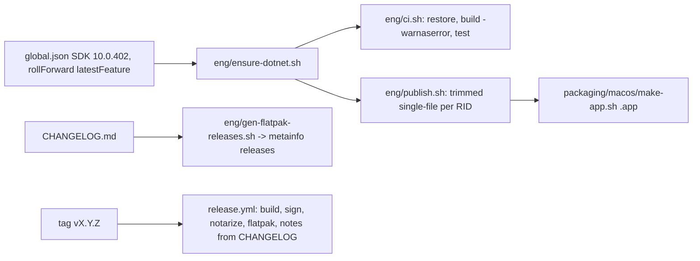

# Build, toolchain, and release

## SDK

- Lives at `~/.dotnet`, not on default PATH. Scripts source `eng/ensure-dotnet.sh`, which installs
  the global.json channel via `dotnet-install.sh` when `dotnet --version` fails. Ad hoc:
  `export PATH="$HOME/.dotnet:$PATH"`.
- **macOS gotcha**: `dotnet-install.sh` overwrites the signed `~/.dotnet/dotnet` host in place, and
  the kernel then SIGKILLs it (exit 137) due to the cached code signature. Fix:
  `cd ~/.dotnet && cp dotnet dotnet.new && mv dotnet.new dotnet`.

## MSBuild layout

- `Directory.Build.props`: TFM, nullable, `AnalysisLevel latest-recommended`, `EnforceCodeStyleInBuild`.
- `Directory.Packages.props`: central package management; the only place versions appear.
- `tests/Directory.Build.props`: test stack (Exe output, xunit.v3 3.x, Test.Sdk, runner.visualstudio,
  coverlet.collector), imports the root props explicitly.
- Suppressions: `.editorconfig` (Device.cs/Cart.cs, `flashkit_md` namespace), `tests/.editorconfig`,
  justified `[SuppressMessage]` (e.g. MD5/SHA-1 in RomHash are identity hashes).

## Publish

RIDs: linux-x64, linux-arm64, osx-x64, osx-arm64, win-x64 (`RIDS`, `VERSION` overrides).
Must keep `-p:IncludeNativeLibrariesForSelfExtract=true` (without it the serial native lib is not
embedded and no port opens; shipped broken twice). Trimmed + InvariantGlobalization; must stay at
zero IL2xxx warnings.

## Dependencies and Dependabot

- `.github/dependabot.yml`: weekly nuget (Avalonia* grouped: must move in lockstep), github-actions,
  dotnet-sdk.
- **xunit.v3 is held at 3.x** (major bumps ignored): Avalonia.Headless.XUnit (<= 12.1.4) is compiled
  against xunit v3 3.2.2 and GUI tests fail discovery under v4 with `MissingMethodException`. v4 also
  needs the MTP runner: `"test": {"runner": "Microsoft.Testing.Platform"}` in global.json,
  `dotnet test --solution flashkit-md.sln`, and dropping Test.Sdk/runner.visualstudio/coverlet.collector.
- Keep System.IO.Hashing and System.IO.Ports on the same servicing version.

## Changelog and release

HashiCorp style, `## Unreleased` gets entries with each user-visible change. Release: rename
Unreleased to `## X.Y.Z (Month D, YYYY)`, commit, tag `vX.Y.Z`. The workflow fails if the section is
missing. Signing/notarization secrets: `docs/RELEASING.md`. Flatpak metainfo `<releases>` is generated,
never hand-edited.

Related: [../testing/summary.md](../testing/summary.md), [../plans/backlog.md](../plans/backlog.md).
