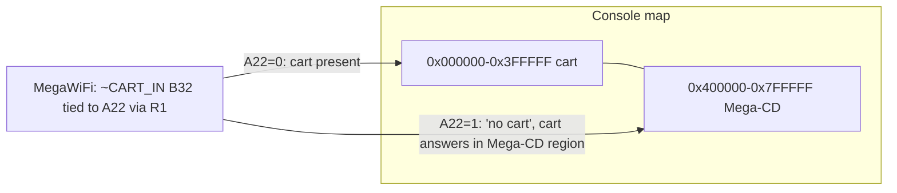

# Cart address space and the 8 MiB limit

The FlashKit drives 24-bit word addresses (`Device.setAddr`), but a Mega Drive cart normally owns only
0x000000-0x3FFFFF; 0x400000-0x7FFFFF belongs to the Mega-CD. Core treats 8 MiB (`MaxCartBytes`) as the
cart ceiling and 4 MB (`DefaultChipBytes`) as the assumption when a chip's size is unknown.



## MegaWiFi flat 8 MiB

- R1 (0 Ω) ties edge pin B32 (`~CART_IN`) to A22. On a console, `~CART_IN` low maps the cart low,
  high maps it into the Mega-CD region, so the S29GL064N (word mode) answers flat across 8 MiB. Cost:
  Mega-CD unusable while fitted; R2 instead gives a standard 4 MiB cart (never fit both: shorts A22).
- On the FlashKit, A22 reaches the chip and B32 does not hold it low (2026-10-28): a 64 KB marker at
  0 did not appear at any power-of-two offset 0x10000-0x400000 nor 0x600000/0x7F0000; then a full
  8 MiB image with distinct halves wrote, verified and dumped back byte-identical.

## Rules

- Never read above 4 MB on a cart that has not asked for it: `ProbeRomSize` requires a header
  declaring > 4 MB first ([flash-and-save.md](flash-and-save.md)). Standard carts ground B32; reads
  with A22 high just mirror, but keep the exposure minimal.
- Writes are bounded by the chip's CFI size, never by the address space alone.
- IPS cannot encode a change at offset 0x454F46 ("EOF"); `IpsPatch.GuardOffset` throws if a >4 MB
  diff hits it. xdelta handles >4 MB targets (multi-window).

```csharp
int chipBytes = DefaultChipBytes;                       // 4 MB
if (!skipFlashCheck && CheckFlash().SizeBytes is > 0 and var cfiBytes)
    chipBytes = Math.Min(cfiBytes, MaxCartBytes);       // MegaWiFi: 8 MiB
```

Related: [flash-identification.md](flash-identification.md), [flash-and-save.md](flash-and-save.md),
`~/Desktop/mega_wifi/lode/hardware/summary.md` (schematic notes).
