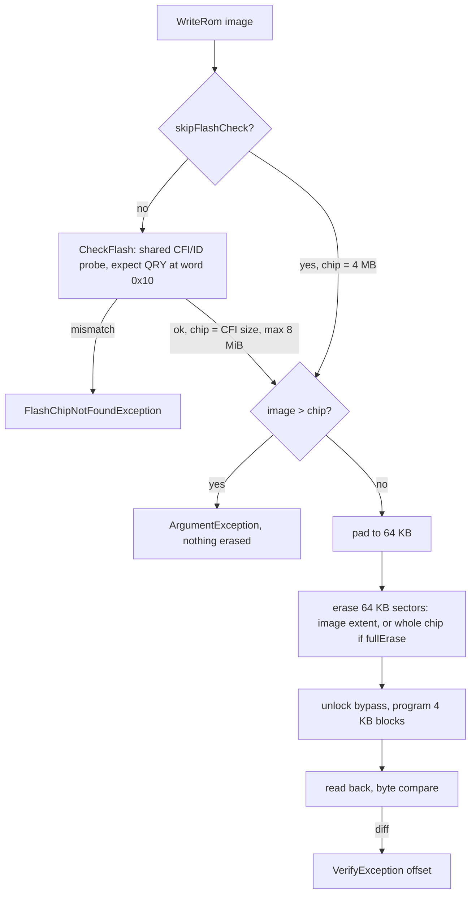

# Cart operations: ROM, flash, and save RAM

Domain rules behind `FlashKitSession`'s cart workflows (ported from the
original Form1 handlers plus safety checks the original lacked).



## ROM

- Size detection is mirror probing (`Cart.getRomSize`, verbatim, stops at 4 MB). On a partially
  erased flash cart it can report sizes a mask ROM never would; `ReadHeaderRomSize()` /
  `--trust-header` uses the header's end address at 0x1A4 (+1) instead (plausible up to 8 MiB).
- `ProbeRomSize` (Core) extends past 4 MB only when the probe hit 4 MB **and** the header declares
  more **and** 512-byte samples at 0x400000+k differ from k (k = 0, 512K, ... 3.5M); then 8 MiB.
  The header gate keeps A22-high reads off ordinary carts; SSF2-style mapper carts (header 5 MB)
  mirror there and stay 4 MB. See [address-space.md](address-space.md).
- 32X carts: "32X" in the 16-byte system field at 0x100. Suggested dump extension `.32x`, else `.bin`.
  Verified on DOOM and Kolibri vs five MD titles.
- Suggested names collapse runs of spaces in the 48-char header name.

## Flash writes

- Default erase covers only the image extent (original parity). Stale flash above it shows up in
  games as **ghost saves**.
- Chip size = `CheckFlash().SizeBytes` (CFI), capped at 8 MiB; 4 MB when CFI has no size or
  `skipFlashCheck`. An image larger than the chip throws `ArgumentException` before any erase
  (the original silently truncated at 4 MB).
- `--full-erase` erases exactly the chip size, so smaller mirrored chips are no longer
  over-erased. Still opt-in (it is slow: ~216 s for erase+write+verify of 8 MiB).
- On any exception the session calls `flashResetByPass()` best-effort before rethrowing.

## Save RAM

- 8-bit on **odd bytes** of a word stream; even bytes read as open bus 0xFF. Verifies skip even bytes.
- Banked at 0x200000 behind the 0xA13000 register (`writeWord(0xA13000, 0xffff)` maps it in).
- `ramSize == 0` -> `SaveRamNotFoundException`. Uses `setDelay(1)` (ROM paths use 0).
- `WriteRam` truncates to the cart's size and to an even length, returns words sent.

```csharp
for (int i = 0; i < copyLen; i++)
{
    if (i % 2 == 0) continue; // save RAM is 8-bit, on odd bytes
    if (ram[i] != ram2[i]) throw new VerifyException(i);
}
```

## Bake-save

The validated FlashKit flash cart has **no SRAM**. `BakeSave` programs a `.srm` snapshot into flash
at 0x200000: games load it and it survives power cycles, but in-game saves cannot overwrite it.
Requires a 4 MB chip; input must be non-empty, even length, at most 1 MB.

## Hardware notes

- "Unknown (X) / 0K" (`CartInfo.CartDetected == false`, CLI `No cart detected ...`) almost always
  means an unseated cart. A blank flash cart is distinguished by the flash ID probe
  ([flash-identification.md](flash-identification.md)).
- Real-hardware results live in `docs/hardware-validation.md`; James runs hardware tests himself.

Related: [../core/summary.md](../core/summary.md), [../core/serial-protocol.md](../core/serial-protocol.md),
[../testing/summary.md](../testing/summary.md).
