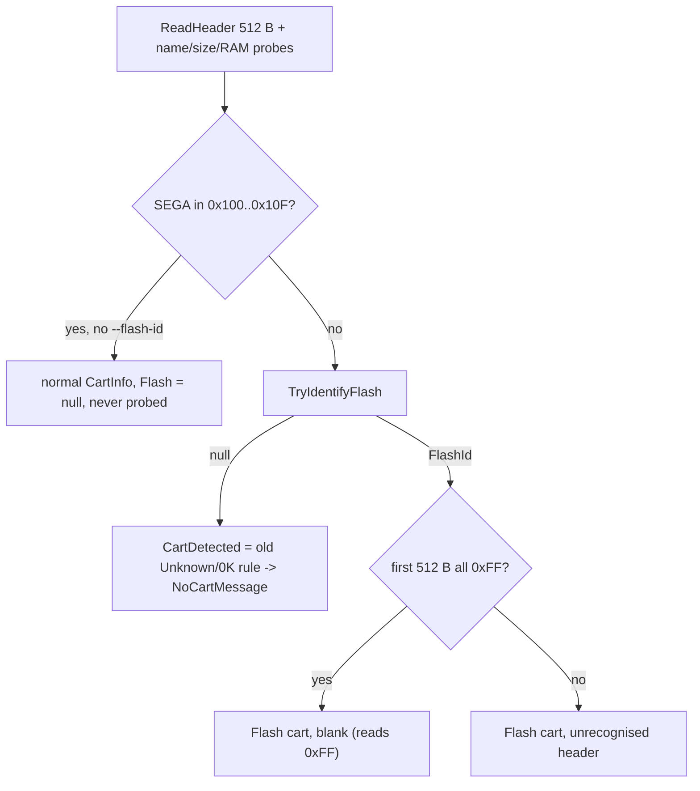

# Flash identification and cart detection

How `GetInfo` decides what is in the slot. The header alone cannot tell a
blank flash cart from an empty slot (both read 0xFF everywhere), so a cart
with no valid header gets a read-only flash ID probe. Lives in
`FlashKitSession` (Core), so CLI, GUI and TUI all show the same result.



## Probe sequence (`ProbeFlash`, shared by `TryIdentifyFlash` and `CheckFlash`)

1. Baseline: read 0x20 bytes at byte 0 in read-array mode.
2. CFI: `writeByte(0x55*2, 0x98)`, read 6 bytes at byte 0x20, expect `00 51 00 52 00 59`. If QRY,
   read 2 bytes at byte 0x4E (CFI word 0x27); low byte n -> size 2^n (accepted for n in 10..30).
   `writeWord(0, 0xF0)`.
3. Autoselect: `writeWord(0x555*2, 0xAA)`, `(0x2AA*2, 0x55)`, `(0x555*2, 0x90)`; read 0x20 bytes at
   byte 0: words at bytes 0x00 (mfr), 0x02, 0x1C, 0x1E (device ID 1/2/3). `writeWord(0, 0xF0)`.
4. On any exception: best-effort `writeWord(0, 0xF0)`, then rethrow.

The ID counts only if some ID word differs from the baseline: a mask ROM or floating bus ignores
autoselect and reads the same data, so this rejects ROM bytes masquerading as an ID while still
identifying non-CFI chips. Result is null when neither CFI nor the ID answered.

```csharp
public sealed record FlashId(bool CfiOk, int SizeBytes, ushort Manufacturer, IReadOnlyList<ushort> DeviceId);
FlashId? id = session.TryIdentifyFlash();
id?.Describe();          // "CFI OK, 8 MiB, mfr 0x0001 dev 227E/2210/2200 (Spansion S29GL064N family)"
id?.ShortDescription;    // "8 MiB flash, Spansion S29GL064N family" (GUI/TUI ROM-size field)
```

## Invariants

- Read-only: only 0x98 (CFI), AA/55/90 (autoselect) and 0xF0 (reset). Never erase/program.
  Locked byte-for-byte by `FlashIdentifyTests.probe_decodes_real_hardware_replies...`.
- Chip always ends in read-array mode.
- Valid-header carts (mask ROM, SRAM/mapper carts) are not probed unless `GetInfo(probeFlash: true)`
  / CLI `info --flash-id`. Headerless carts are probed on every GUI/TUI poll (harmless, read-only).
- `CheckFlash` (pre-write guard) = `ProbeFlash(...)?.CfiOk != true` -> `FlashChipNotFoundException`
  with the raw CFI bytes. One CFI implementation.
- `CartInfo.CartDetected` is true when `Flash != null`; `HeaderlessFlashStatus` is the status line
  for flash with no valid header (null otherwise). `CartInfo.NoCartMessage` is the nothing-answered
  text. CLI exit code for `info` is 0 in every case.
- Chip table (`FlashId.Chips`) is keyed on mfr + all three device words; add only from datasheets or
  real reads. Unknown IDs fall back to a JEDEC manufacturer name, then raw hex.

## Front-end rendering

- CLI `info`: `Cart :` + `Flash :` lines (plus mirror-probed ROM size / RAM size only when nonzero);
  `--flash-id` appends a `Flash :` line to normal output (`no flash chip answered` on mask ROM).
- `ProgrammerModel.ShowCartState`: CartName = status line, ROM size = `ShortDescription`,
  system/region/header = "—". Auto-dump skips headerless flash (nothing to dump by); auto-write fires
  on insertion, which is the point of flashing blank carts.

## Lessons

- Hit on a factory-blank MegaWiFi Rev.C (S29GL064N, 8 MiB): `info` looked dead while `write-rom`
  worked. Reference reads are in `docs/hardware-validation.md` (2026-10-28).
- `write-rom` still caps images at 4 MB; 8 MiB support is a separate task
  ([../plans/backlog.md](../plans/backlog.md)).

Related: [flash-and-save.md](flash-and-save.md), [../core/summary.md](../core/summary.md),
[../presentation/programmer-model.md](../presentation/programmer-model.md),
[../testing/summary.md](../testing/summary.md).
