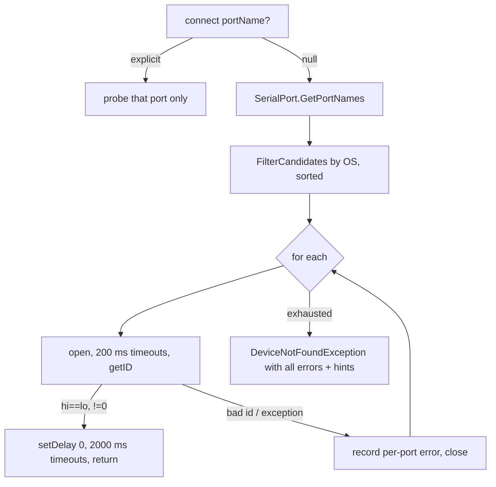

# Port discovery (`PortDiscovery` / `DeviceConnector`)

The programmer is an **FTDI** USB-serial device. Auto-detection scans only
the node patterns FTDI produces; `--port` (CLI) bypasses filtering entirely.

| OS | Scanned | Deliberately skipped |
|---|---|---|
| Linux | `/dev/ttyUSB*` | `ttyS*` (phantom stubs), `ttyACM*` (CDC-ACM) |
| macOS | `/dev/cu.usbserial*` | `tty.*` (block on open), `cu.usbmodem*` (CDC-ACM) |
| Windows | `COM*` | — (no name-level distinction available) |
| Other | everything | |



## Invariants

- Never probe CDC-ACM ports. Opening one asserts DTR/RTS, which **resets ESP32/Arduino boards**
  (e.g. the MegaWiFi cart's native USB-C), and the probe/abandoned close keeps the port busy so
  esptool reports "port busy" until the app quits. The GUI poll would repeat this every tick.
- Errors are surfaced per port, never swallowed. Linux permission errors add a group/udev hint
  (`dialout`, `uucp` on Arch; `packaging/99-flashkit-md.rules`).
- Zero candidates produces "no candidate serial ports found (expected ...)" naming the patterns.
- Seams: `DeviceConnector(enumeratePorts, portFactory, os)` so tests run without hardware.

```csharp
PortDiscovery.FilterCandidates(new[] { "/dev/cu.usbmodem1101", "/dev/cu.usbserial-A50285BI" }, HostOs.MacOs)
// => { "/dev/cu.usbserial-A50285BI" }
```

## Known gap

An ESP32 board with its own CP210x/CH340 bridge can still appear as `cu.usbserial-*` / `ttyUSB*`
and be probed. A robust fix is USB VID matching (FTDI 0x0403) per OS (sysfs, IOKit, SetupAPI);
tracked in [../plans/backlog.md](../plans/backlog.md).

Related: [serial-protocol.md](serial-protocol.md), tests in `tests/FlashKit.Core.Tests/PortDiscoveryTests.cs`.
