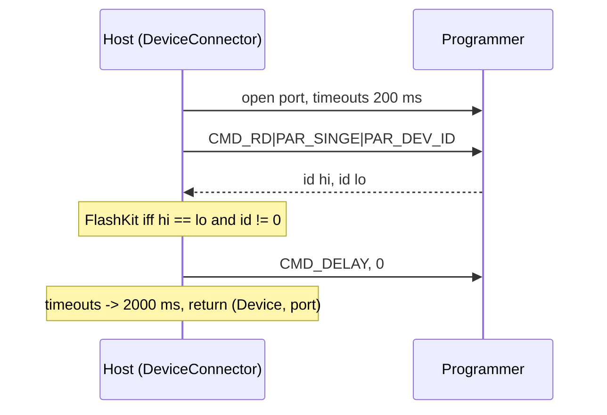

# Serial protocol (`Device.cs`)

Byte-oriented command stream to the programmer firmware. Exact sequences are
locked by `DeviceWireFormatTests` (never "fix" those to match changed code).

## Command bytes

| Const | Value | Meaning |
|---|---|---|
| CMD_ADDR | 0 | next byte is one address byte (sent 3x: hi, mid, lo of word address) |
| CMD_LEN | 1 | next byte is one length byte (sent 2x) |
| CMD_RD | 2 | read |
| CMD_WR | 3 | write |
| CMD_RY | 4 | wait for flash ready |
| CMD_DELAY | 5 | set bus delay (connect sets 0) |
| PAR_INC | 128 | auto-increment address (block transfer) |
| PAR_SINGE | 64 | single word |
| PAR_DEV_ID | 32 | read device ID instead of bus |
| PAR_MODE8 | 16 | 8-bit write |

Addresses on the wire are word addresses (`addr / 2`). Reads return big-endian words.

```csharp
// readWord(addr): 7 bytes out, 2 bytes back
cmd = { CMD_ADDR, a>>16, CMD_ADDR, a>>8, CMD_ADDR, a, CMD_RD|PAR_SINGE };
```

## Handshake



## Flash commands

AMD command set via `writeWord`/`writeByte` at 0x555*2 / 0x2AA*2 (unlock AA/55, erase 80/AA/55/30,
unlock bypass). Programming can only clear bits; the fake device enforces AND semantics so a
skipped erase fails tests. `CMD_RY` polls ready after erase.

## Serial adapter

`SystemSerialPort` wraps `System.IO.Ports.SerialPort` behind `ISerialPort` (the test seam).
Its `Close()` is guarded: discard output buffer, close on a worker, abandon after 2 s.
Reason: macOS FTDI `tcdrain` can wedge forever after multi-MB writes. An abandoned close frees
the descriptor only at process exit, hence the held session in
[../presentation/programmer-model.md](../presentation/programmer-model.md). Covered by
`SystemSerialPortTests`; keep the behavior.

Related: [summary.md](summary.md), [port-discovery.md](port-discovery.md).
