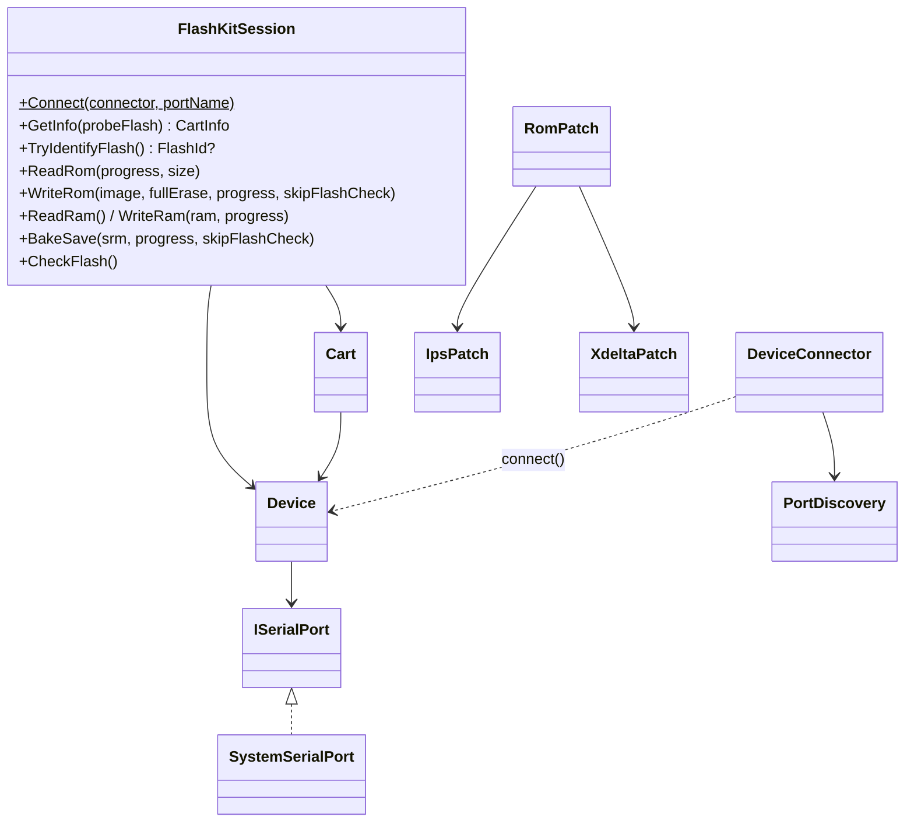

# Core library (`src/FlashKit.Core/`)

Everything device-related lives here; front-ends only render. Pure helpers
(patches, hashes) are original code; `Device`/`Cart` are verbatim ports.



## Contracts

- `FlashKitSession` is synchronous, owns the port (closes on Dispose), does no console/file I/O.
- Progress: `OperationProgress(Phase, Done, Total)`, phases Read/Erase/Write/Verify, each starts with Done=0.
- Errors: `VerifyException(Offset)` on read-back mismatch, `SaveRamNotFoundException`,
  `FlashChipNotFoundException` (CFI probe failed: mask ROM or unseated), `DeviceNotFoundException`
  (carries per-port `PortErrors`).
- `CartInfo(RomName, RomBytes, RamBytes, HeaderRomBytes?, Is32X, Region, HeaderValid, HeaderBlank,
  Flash?)`; `CartDetected` is false for the "Unknown / 0K" floating-bus signature unless a flash chip
  answered; `HeaderlessFlashStatus` names blank/unrecognised flash; `SystemName` is "Sega 32X" or
  "Mega Drive / Genesis". Headerless carts get the read-only flash ID probe
  ([../cart/flash-identification.md](../cart/flash-identification.md)).
- `RomPatch` dispatches IPS vs xdelta: Apply sniffs magic, Create keys off output extension
  (`.xdelta`/`.vcdiff` -> xdelta, else IPS). `RomHash` gives CRC32/MD5/SHA-1 as uppercase hex;
  every read/write path reports them.

```csharp
using var s = FlashKitSession.Connect();          // scans ports, or Connect(portName: "/dev/ttyUSB0")
CartInfo info = s.GetInfo();
byte[] rom = s.ReadRom(p => Console.Write($"\r{p.Phase} {p.Done}/{p.Total}"),
                       size: s.ReadHeaderRomSize()); // --trust-header
```

## Verbatim rule

`Device.cs`/`Cart.cs` keep the original's lowercase names and structure so they diff against
https://github.com/krikzz/flashkit (`flashkit-md/`; pristine import is in git history, commit
"Import pristine FlashKit MD v1.0.0.0 source"). Behavior changes go in `FlashKitSession` or
separate commits with tests. Analyzer relaxations for these files live in `.editorconfig`.

Related: [serial-protocol.md](serial-protocol.md), [port-discovery.md](port-discovery.md),
[../cart/flash-and-save.md](../cart/flash-and-save.md).
