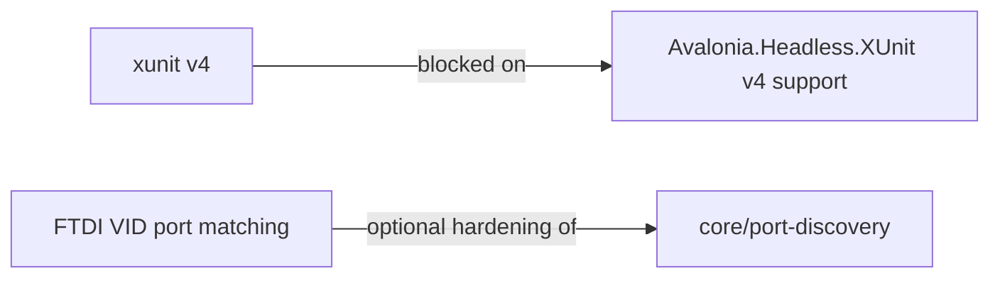

# Backlog

Open items not yet decided or blocked. Remove entries when done; the lode
describes current state.

## xunit.v3 4.x (blocked)

Blocked until Avalonia.Headless.XUnit ships against xunit v4 (checked 12.1.4 on 2026-10-27: still
depends on `xunit.v3.extensibility.core` 3.2.2). When it does: remove the dependabot `ignore` for
xunit.v3, opt into MTP in global.json, switch ci.sh/ci.yml to `dotnet test --solution`, drop
Test.Sdk / runner.visualstudio / coverlet.collector. Details: [../build/toolchain.md](../build/toolchain.md).

## Port matching by USB VID (idea)

Name filtering cannot exclude non-FTDI USB-serial bridges (CP210x, CH340) that also enumerate as
ttyUSB / cu.usbserial, e.g. ESP32 dev boards. Matching FTDI VID 0x0403 would need per-OS lookups:
Linux `/sys/class/tty/<n>/device/../../idVendor`, macOS IOKit/ioreg, Windows SetupAPI/registry.
Not started; awaiting a decision. See [../core/port-discovery.md](../core/port-discovery.md).
