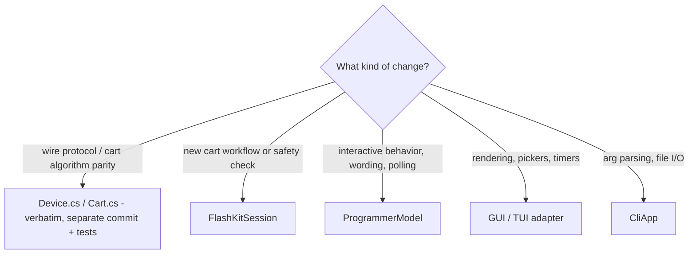

# Practices

Condensed working rules. CLAUDE.md is the authoritative agent rulebook;
this file adds the *why* and lessons. See [build/toolchain.md](build/toolchain.md)
and [testing/summary.md](testing/summary.md).

## Where code goes

- Front-ends only render. A behavior that exists in both GUI and TUI belongs in `ProgrammerModel`.
- `FlashKitSession` does no console or file I/O; progress is `Action<OperationProgress>`, each phase starts at Done=0.

## Change hygiene

- Every user-visible change adds a `## Unreleased` CHANGELOG entry in the same commit
  (HashiCorp style, `component:` prefix: cli, gui, tui, core, serial, release, docs).
- Docs audiences stay separate: README (users), DEVELOPING (contributors), CLAUDE.md (agent rules).
- Run `./eng/ci.sh` before committing; it is `-warnaserror` and should stay ~5-10s.
- Analyzer hits: fix, or suppress narrowly with a written justification. Use `--no-incremental`
  to verify analyzer fixes (MSBuild writes outputs even when warnings fail the build).
- Bump NuGet versions only in `Directory.Packages.props`. Move paired packages together
  (Avalonia family; System.IO.Hashing + System.IO.Ports).

## Safety

- NEVER commit ROMs/saves. `dumps/` and root `*.bin` are gitignored; avoid `git add -A`
  (it once pushed ROMs that required a history rewrite). Prefer `git add -u` or explicit paths.
- Hardware testing is manual and done by James; order info -> read-rom -> read-ram -> write-ram -> write-rom.
  Record results in `docs/hardware-validation.md`.
- "Unknown (X) / 0K" from info means reseat the cart before debugging.

## Lessons learned

- Probing a port is not free: opening a serial port asserts DTR/RTS, which resets ESP32/Arduino
  boards. Only scan port patterns the FTDI programmer can actually appear as
  ([core/port-discovery.md](core/port-discovery.md)).
- Upstream test helpers can pin a test framework major version (Avalonia.Headless.XUnit -> xunit v3 3.x);
  check them before accepting a test-framework major bump ([plans/backlog.md](plans/backlog.md)).
- "Not detected" with the programmer plugged in: first run `lsof /dev/cu.usbserial-*`. GUI/TUI
  instances hold the port for their whole lifetime, so a stale second instance (e.g. an old
  `artifacts/` build next to a downloaded `.app`) silently starves the new one.
