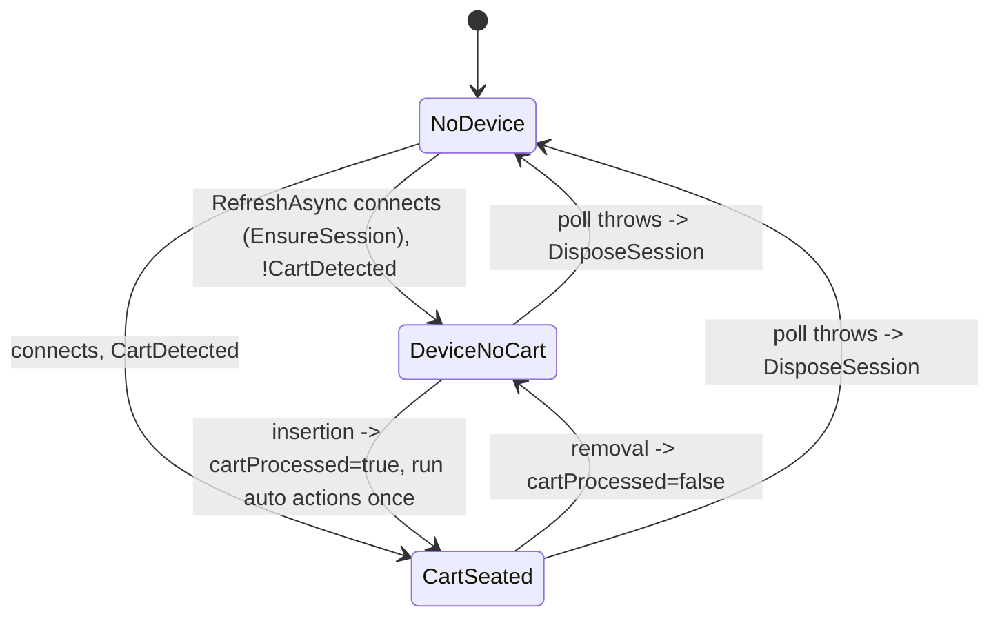

# ProgrammerModel (`src/FlashKit.Presentation/`)

Toolkit-agnostic presentation model shared by GUI (Avalonia) and TUI
(Terminal.Gui). Owns **all** interactive behavior; adapters only bind
properties, implement `IUserPrompts`, and run the poll timer.



## Contracts

- **Threading**: every public member is called on the UI thread. Device I/O runs via `Task.Run`;
  results and progress marshal back, so `PropertyChanged` fires on the caller's thread. Production
  relies on Avalonia's dispatcher / Terminal.Gui's main-loop SynchronizationContext.
- **Device gate**: `SemaphoreSlim(1,1)`. `RefreshAsync` uses `WaitAsync(0)` and skips the tick if an
  operation is running; operations take the gate through `RunOperation`.
- **Held session**: one `FlashKitSession` lives while the programmer is reachable, closed only on
  device loss or Dispose. Closing per operation left macOS ports unopenable after write-rom
  (abandoned tcdrain close, see [../core/serial-protocol.md](../core/serial-protocol.md)).
- **Auto actions** (auto-dump ROM/RAM to a folder, auto-write a file) fire on the no-cart -> cart
  transition, deliberately **not** keyed on cart identity: auto-write changes the cart, so
  identity keying would rewrite in a loop. `cartProcessed` resets on removal, device loss, or any
  auto-setting change; failures are not retried every poll. Auto-dump and auto-write are mutually
  exclusive (`CanToggleAutoDump` / `CanToggleAutoWrite`). A blank/unrecognised flash cart counts as
  inserted: auto-write fires, auto-dump skips it ([../cart/flash-identification.md](../cart/flash-identification.md)).
- Dumps never overwrite: `UniquePath` appends " (2)", " (3)", ...
- `Log` (`ObservableCollection<TransactionEntry>`) is the transaction log both UIs render.

```csharp
var model = new ProgrammerModel(prompts, connector);   // connector seam for tests
timer.Tick += async (_, _) => await model.RefreshAsync();
await model.ReadRomAsync();                              // prompts for file via IUserPrompts
```

## Operations

`ReadRomAsync`, `WriteRomAsync`, `CreatePatchAsync`, `ReadRamAsync`, `WriteRamAsync`, plus patch
toggles (`RequestApplyPatchAsync`, `ChoosePatchFileAsync`). User decisions go through
`IUserPrompts` (`PromptFileKind`: RomImage, SaveRam, Patch).

## Adapters

- GUI `MainWindow` has connector and file-picker seams; headless tests drive it against the fake.
- TUI `ProgrammerTuiWindow` mirrors the same panel roles; views work without `Application.Init`.
- Linux GUI shutdown: `DBusShutdownWorkaround` disposes the DBus connection on the UI thread
  (AvaloniaUI/Avalonia#19523).
- GUI is published trimmed; it relies on compiled bindings (`x:DataType`), so any IL2026 warning
  must be fixed, not suppressed ([../build/toolchain.md](../build/toolchain.md)).

Related: [../core/summary.md](../core/summary.md), [../testing/summary.md](../testing/summary.md).
