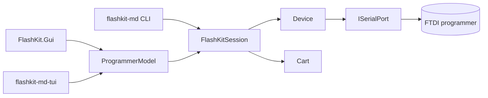

# Summary

flashkit-md-dotnet is a cross-platform .NET 10 port of krikzz's FlashKit MD
programmer client: it dumps and flashes Sega Mega Drive / Genesis (and 32X)
cartridges over an FTDI USB-serial programmer. It is library-first: all
device workflows live in `FlashKit.Core` (verbatim-ported `Device`/`Cart`
plus the `FlashKitSession` API), interactive behavior in
`FlashKit.Presentation.ProgrammerModel`, and three thin front-ends render it
(CLI `flashkit-md`, Avalonia GUI, Terminal.Gui TUI). Releases ship as
self-contained trimmed single-file binaries for linux/osx/win, a macOS
`.app`, and a Flatpak. The owner (James) is currently also building a new
cartridge type (MegaWiFi, ESP32-based, see `~/Desktop/mega_wifi`), which is
why port discovery must never touch CDC-ACM ports.

Related: [lode-map.md](lode-map.md), [core/summary.md](core/summary.md),
[presentation/programmer-model.md](presentation/programmer-model.md).
