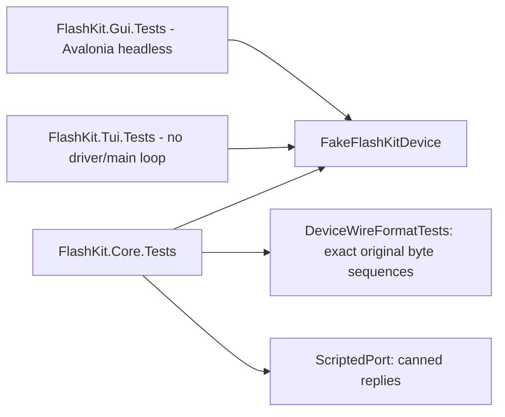

# Testing

Whole suite is in-memory, no hardware, no sleeps or clock; `./eng/ci.sh` runs all
three projects (~220 tests) in a few seconds. CI matrix: ubuntu, macos, windows.



## Fakes and seams

- `FakeFlashKitDevice` (an `ISerialPort`): emulates firmware + synthetic cart: mirrored ROM, banked SRAM
  at 0x200000 behind 0xA13000, AMD flash commands with AND semantics (skipped erase fails tests).
- Fake flash chip also answers autoselect (`FlashManufacturer`/`FlashDeviceIds`, default S29GL064N)
  and CFI size (`CfiSizeExponent`, default 0x17). `FlashQueryCount` / `FlashModifyCount` let tests
  assert a cart was never probed / never erased or programmed.
- `ScriptedPort`: enqueue raw reply bytes, e.g. a bad device ID, or the real MegaWiFi probe replies
  (`FlashIdentifyTests`).
- `DeviceConnector(enumeratePorts, portFactory, os)` lets tests pick an OS and port set:

```csharp
var connector = new DeviceConnector(() => ports.Keys.ToArray(), name => ports[name], HostOs.MacOs);
```

- GUI: `MainWindow` connector/file-picker seams, `[AvaloniaFact]`, `TestAppBuilder` assembly attribute.
- TUI: Terminal.Gui views constructed directly, no `Application.Init`.

## Rules

- Never edit `DeviceWireFormatTests` to match changed code; they lock the wire format.
- Temp files only via the CliTests pattern.
- `IpsRealAssetTests` no-op unless `dumps/ips-fixtures/` (base.bin, patch.ips, patched.bin) or
  `FLASHKIT_IPS_FIXTURES` exists; that content is real ROM data and never committed.
- Test names are snake_case sentences (analyzer exemption in `tests/.editorconfig`).
- Hardware validation is manual (James), recorded in `docs/hardware-validation.md`.

Related: [../build/toolchain.md](../build/toolchain.md), [../core/port-discovery.md](../core/port-discovery.md).
